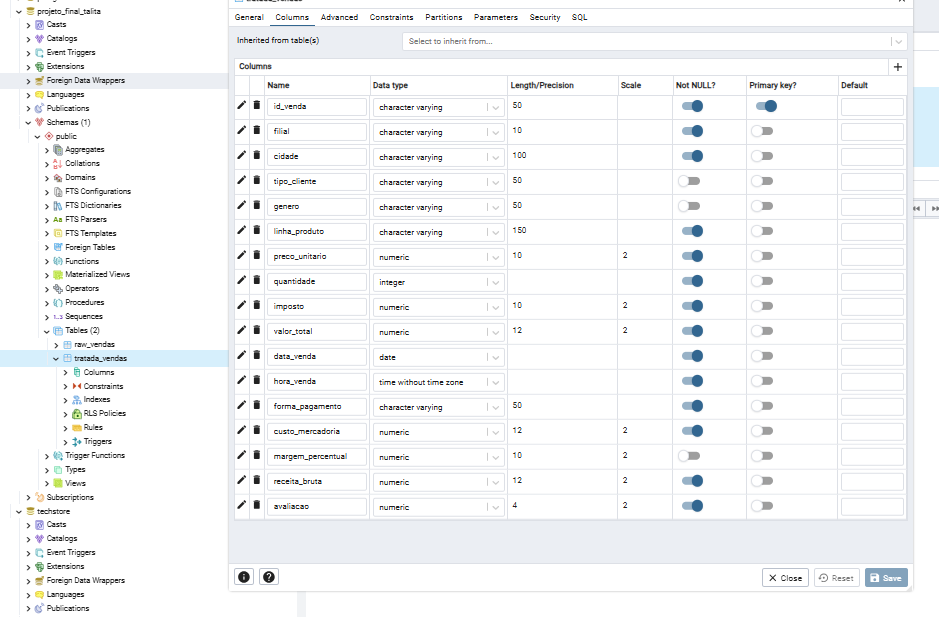
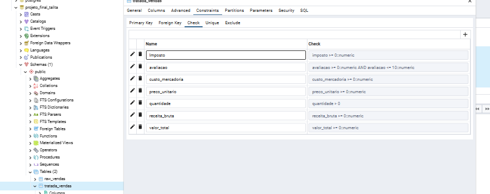
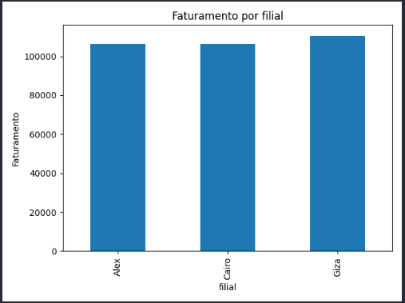
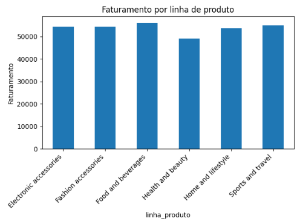
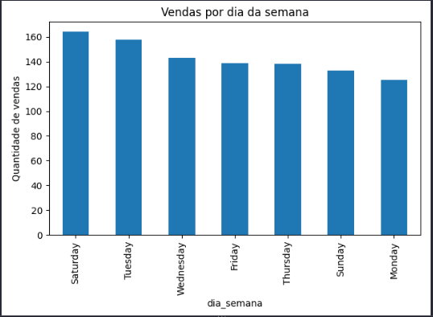

## Projeto Avaliativo - Análise de Dados com Python - T4 SCTECH

## TALITA IARA DOS SANTOS

## Objetivo

- Projeto de análise de dados desenvolvido com Python, Pandas, SQL e PostgreSQL para organizar dados de vendas e gerar informações úteis para a tomada de decisão.
- Perguntas do negócio:
  - Qual filial apresentou o maior faturamento?
  - Qual filial realizou a maior quantidade de vendas?
  - Qual linha de produto apresentou o maior faturamento?
  - Qual linha de produto recebeu a melhor avaliação média?
  - Qual foi a forma de pagamento mais utilizada?
  - Qual foi o valor médio das vendas?
  - Qual foi a maior venda registrada?
  - Em qual dia da semana ocorreu a maior quantidade de vendas?

## Tecnologias utilizadas

- Python
- Pandas
- Matplotlib
- PostgreSQL
- SQL
- Git e GitHub

## Estrutura do projeto

```
projeto-techstore-etl/
├── data/
│   ├── raw/
│   │   └── SuperMarket Analysis.csv       # Entrada bruta dos dados
│   │   └── produtos_extraidos.csv         # Dados extraidos pelo arquivo 04_extracao_produtos.py
│   └── processed/
│       └── vendas_tratadas.csv            # Saída processada do ETL 02_etl_vendas.py
├── resultados/                            # Análises geradas
│   ├── faturamento_por_filial.csv
│   ├── vendas_por_filial.csv
│   ├── faturamento_por_produto.csv
│   ├── avaliacao_por_produto.csv
│   ├── formas_pagamento.csv
│   ├── valor_medio_vendas.csv
│   ├── maior_venda.csv
│   ├── vendas_por_dia_semana.csv
│   ├── faturamento_por_filial.png
│   ├── faturamento_por_produto.png
│   └── vendas_por_dia_semana.png
├── sql/
│   ├── 01_criar_banco.sql                 # Banco
│   ├── 02_criar_tabelas.sql               # Tabelas
│   └── 03_consultas.sql                   # Consultas geradas
├── src/
│   ├── 01_leitura_dados.py                # Leitura e exploração dos dados
│   ├── 02_etl_vendas.py                   # Tratamento dos dados e salvamento em CSV
│   ├── 03_estatistica.py                  # Análises estatísticas e geração de gráficos
│   ├── 04_extracao_produtos.py            # Extração dos dados de produtos
├── .env                                   # Configurações locais do PostgreSQL
├── .gitignore                             # Arquivos que não devem ser versionados
├──requirements.txt                       # Dependências Python
└── README.md                              # Documentação do projeto
```

## Fonte dos dados

Dataset Supermarket Sales, disponível no Kaggle: [www.kaggle.com/datasets/faresashraf1001/supermarket-sales](https://www.kaggle.com/datasets/faresashraf1001/supermarket-sales)

## Desenvolvimento do projeto

Criar o repositório do Git Hub: [github.com/talita-iara/projeto_final_modulo1](https://github.com/talita-iara/projeto_final_modulo1/tree/main)

Acessar o link para baixar a base de dados a ser trabalhada.

Criar arquivo README para documentar as etapas e decisões do projeto.

Criar as pastas conforme orientação do projeto.

### Exploração dos dados:

No VS Code, realizei a exploração dos dados para entender seu conteúdo e avaliar sua integridade e qualidade.

A base possui 1.000 linhas e 17 colunas.

Durante a análise inicial, verifiquei que não existiam valores nulos nem valores negativos ou zerados em colunas como vendas e quantidade. Também identifiquei a necessidade de ajustar os tipos de dados, como nas colunas de data e hora.

### Tratamento dos dados:

Verifiquei os dados das categorias e realizei o tratamento das colunas de data e hora.

Após o tratamento, salvei as informações em um novo arquivo CSV, separado da base original.

### SQL e PostgreSQL:

Criei o banco de dados e as tabelas no PostgreSQL, importando os arquivos trabalhados no VS Code.

Para a tabela de dados tratados, defini os tipos das variáveis e algumas regras para ajudar a manter a integridade dos dados.

Também criei consultas SQL para realizar as pesquisas propostas no projeto. Os resultados foram exportados em arquivos CSV e salvos na pasta resultados.





### Análises e resultados

Nesta etapa, realizei consultas SQL para analisar os dados de vendas e responder às oito perguntas de negócio propostas no projeto. 

Alémdas perguntas principais, também realizei outras duas análises complementares para comparar o valor médio das vendas entre as filiais e identificar as categorias de produtos que mais se destacaram em cada unidade.

Os resultados foram exportados em arquivos CSV e salvos na pasta resultados.


---

1. Qual filial apresentou o maior faturamento?

**Resultado:**

- Giza: 110.568,86
- Alex: 106.200,57
- Cairo: 106.198,00



Análise:  A filial Giza apresentou o maior faturamento, a diferença entre Giza e as outras filiais foi relativamente pequena, mostrando que os resultados de faturamento foram próximos.

---

2. Qual filial realizou mais vendas?

**Resultado:**

- Alex: 340 vendas
- Cairo: 332 vendas
- Giza: 328 vendas

Análise:  A filial Alex realizou o maior número de vendas, mesmo não sendo a que apresentou o maior faturamento. Isso mostra que a quantidade de vendas, sozinha, não determina qual filial terá o maior faturamento.

---

3.Qual categoria de produtos apresentou o maior faturamento?

**Resultado:**

- Food and beverages: 56.144,96
- Sports and travel: 55.123,00
- Electronic accessories: 54.337,64
- Fashion accessories: 54.306,03
- Home and lifestyle: 53.861,96
- Health and beauty: 49.193,84



Análise : A categoria Food and beverages apresentou o maior faturamento, enquanto Health and beauty apresentou o menor. Os resultados mostram que o faturamento foi relativamente próximo entre a maioria das categorias.

---

4. Qual categoria apresentou a melhor avaliação média dos clientes?

**Resultado:**

- Food and beverages: aproximadamente 7,11
- Fashion accessories: aproximadamente 7,03
- Health and beauty: aproximadamente 7,00
- Electronic accessories: aproximadamente 6,92
- Sports and travel: aproximadamente 6,92
- Home and lifestyle: aproximadamente 6,84

Análise: Food and beverages apresentou a maior avaliação média dos clientes, enquanto Home and lifestyle teve a menor. As médias foram próximas, indicando que as avaliações não apresentaram grandes diferenças entre as categorias.

---

5. Qual foi a forma de pagamento mais utilizada?

**Resultado:**

- Ewallet: 345 vendas
- Cash: 344 vendas
- Credit card: 311 vendas

Análise:  A carteira digital (Ewallet) foi a forma de pagamento mais utilizada, com apenas uma venda a mais que o dinheiro em espécie (Cash). O cartão de crédito ficou em terceiro lugar.

Os resultados mostram que as três formas de pagamento foram utilizadas, sem uma diferença muito grande entre as duas primeiras.

---

6. Qual foi o valor médio das vendas?

**Resultado:**

O valor médio das vendas foi de aproximadamente 322,97.

Análise: Em média, cada venda apresentou um valor de aproximadamente 322,97. Esse indicador ajuda a entender quanto os clientes gastaram por compra, considerando o valor total registrado em cada venda.

---

7. Qual foi a maior venda registrada?

**Resultado:**

- Identificação da venda: 860-79-0874
- Valor total: 1.042,65

Análise: A maior venda registrada apresentou o valor de 1.042,65, acima da média geral de 322,97. 

---

8. Em qual dia da semana ocorreu o maior número de vendas?

**Resultado:**

- Sábado: 164 vendas
- Terça-feira: 158 vendas
- Quarta-feira: 143 vendas
- Sexta-feira: 139 vendas
- Quinta-feira: 138 vendas
- Domingo: 133 vendas
- Segunda-feira: 125 vendas



Análise O sábado foi o dia com maior número de vendas, enquanto a segunda-feira apresentou o menor resultado. Essa informação pode ajudar no planejamento das atividades das filiais, considerando os dias com maior movimento.

---

9. Qual filial apresentou o maior valor médio por venda?

**Resultado:**

- Giza: 337,10
- Cairo: 319,87
- Alex: 312,35

Análise: A filial Giza apresentou o maior valor médio por venda, seguida por Cairo e Alex. Isso significa que, em média, as compras realizadas em Giza tiveram um valor maior.

Esse resultado ajuda a complementar a análise de faturamento, pois permite observar não apenas o total arrecadado por cada filial, mas também o valor médio de cada compra.

---

10. Quais categorias se destacaram em cada filial?

**Resultado:**

- **Alex:** Home and lifestyle, com 371 unidades vendidas e faturamento de 22.417,21.
- **Cairo:** Sports and travel, com 322 unidades vendidas e faturamento de 19.988,26.
- **Giza:** Food and beverages, com 369 unidades vendidas e faturamento de 23.766,88.

Análise: Os resultados mostram que as categorias de maior faturamento variam entre as filiais. Giza apresentou o maior faturamento geral e também se destacou na categoria Food and beverages, que teve o maior faturamento entre as categorias quando consideradas todas as filiais.

Essa comparação permite identificar as categorias mais relevantes para cada unidade e ajuda a entender quais produtos contribuem mais para seus resultados.


## Conclusão:

Com as consultas SQL e as análises realizadas em Python, foi possível identificar diferenças no faturamento, na quantidade de vendas, nas categorias de produtos e nas preferências dos clientes.

A filial Giza apresentou o maior faturamento, mesmo realizando menos vendas que Alex. Além disso, Giza teve o maior valor médio por venda, o que ajuda a compreender esse resultado.

A categoria Food and beverages apresentou o maior faturamento geral e a melhor avaliação média dos clientes. Porém, ao comparar as categorias por filial, foi possível observar que cada unidade apresentou resultados diferentes.

Também foi identificado que a carteira digital foi a forma de pagamento mais utilizada e que o sábado concentrou a maior quantidade de vendas.

O desenvolvimento do projeto permitiu praticar a exploração e o tratamento dos dados com Python e Pandas, a criação de tabelas e consultas SQL no PostgreSQL e a geração de gráficos para facilitar a interpretação dos resultados.

Dessa forma, foi possível transformar os dados de vendas em informações que ajudam a compreender melhor o desempenho das filiais e das categorias de produtos.
